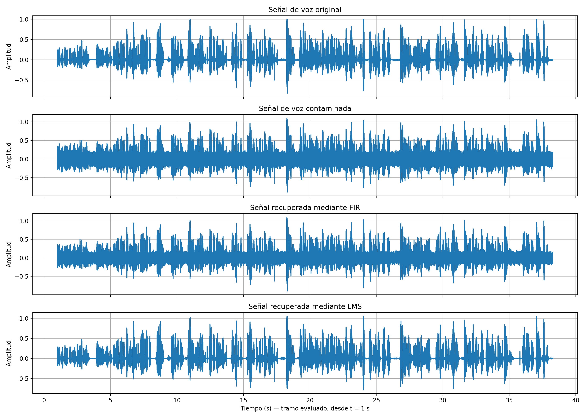
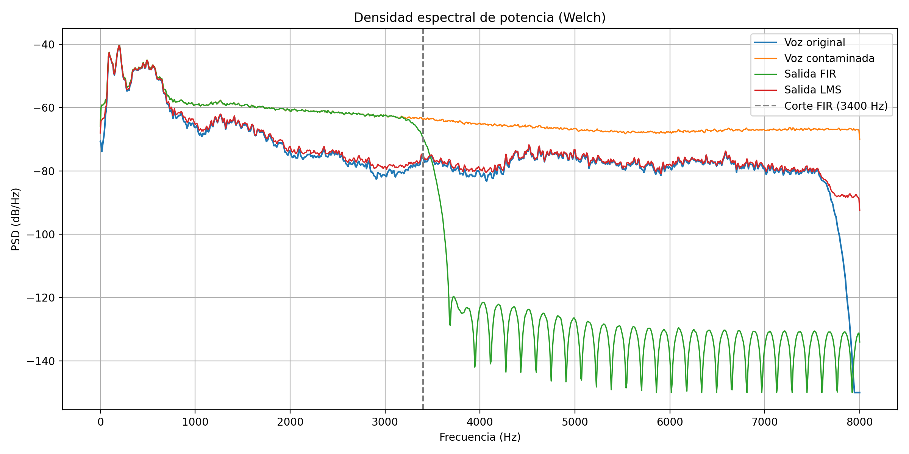

# Diseño y evaluación comparativa de filtros digitales FIR y adaptativos LMS para la eliminación de ruido en señales de audio de voz

**Actividad Sumativa N.º 4 — «El filtro perfecto»** · Desafío de diseño abierto · Unidad III

| | |
|---|---|
| **Universidad** | Universidad Bicentenaria de Aragua — Facultad de Ingeniería, Escuela de Ingeniería de Sistemas |
| **Asignatura** | Sistemas de Señales |
| **Profesor** | Ing. Franklin Morillo |
| **Autor** | Abrahan Salazar |
| **C.I.** | 31.722.088 |
| **Sección** | 1-0 |
| **Contexto de aplicación** | Eliminación de ruido en señales de audio de voz |
| **Herramientas** | Python (NumPy, SciPy, librosa, soundfile, Matplotlib) · Google Colab · GitHub |

📄 **Informe técnico completo:** [`documento/informe_tecnico.pdf`](documento/informe_tecnico.pdf) (también en formato Word en la misma carpeta).

---

## 1. Resumen del proyecto

Se grabó una señal real de voz humana (38,27 s), se remuestreó a 16.000 Hz y se contaminó con ruido a una relación señal-ruido (SNR) inicial de 5 dB. Para recuperarla se implementaron **dos filtros de familias distintas**:

1. **Filtro FIR pasa-bajos con ventana Hamming** (orden 100, 101 coeficientes, frecuencia de corte 3.400 Hz). Es el filtro principal.
2. **Filtro adaptativo LMS** (16 coeficientes) en configuración de cancelación de ruido, con una señal de referencia correlacionada con el ruido y sin voz.

Ambos se evaluaron con **SNR** y **MSE**, tomando la señal original limpia como referencia, y se compararon también en **complejidad computacional**.

## 2. Resultados principales

Comparación en igualdad de condiciones: ambos filtros procesan **la misma señal contaminada** y se evalúan sobre **las mismas muestras** (desde el segundo 1, con el retardo del FIR compensado).

| Criterio | FIR (Hamming, orden 100) | LMS (L = 16) |
|---|---|---|
| SNR de entrada | 5,09 dB | 5,09 dB |
| SNR de salida | 6,28 dB | **16,23 dB** |
| Mejora de SNR | +1,19 dB | **+11,14 dB** |
| MSE de salida | 0,002913 | **0,000295** |
| Reducción del MSE | 24,0 % | **92,3 %** |
| Coeficientes | 101 | 16 |
| Multiplicaciones por muestra | 101 | ≈ 33 |
| Tiempo de ejecución (612.376 muestras) | **0,0223 s** | 3,2051 s |
| Requiere referencia de ruido | No | Sí |
| Estabilidad | Inherente | Depende de μ |

Prueba individual del FIR con ruido blanco gaussiano puro: SNR 4,99 dB → 8,61 dB (+3,61 dB), MSE 0,003839 → 0,001670.





**Conclusión:** para el escenario estudiado, el filtro óptimo según las métricas es el **LMS**, siempre que se disponga de una referencia de ruido correlacionada y sin voz. Si no existe tal referencia, el FIR es la alternativa viable por su estabilidad, fase lineal y bajo costo.

## 3. Aclaraciones técnicas

- **La ventaja del LMS depende de la referencia.** En el experimento la referencia proviene de la misma fuente que genera el ruido (escenario favorable). En aplicaciones reales la referencia suele estar parcialmente contaminada con voz y el desempeño sería menor.
- **El ruido de la comparación no es blanco puro:** es ruido blanco gaussiano que pasa por un canal de tres coeficientes `[1; 0,5; 0,25]`. Esto explica que el FIR rinda menos (+1,19 dB) que en la prueba con ruido blanco puro (+3,61 dB); el informe lo analiza con una estimación teórica (3,72 dB y 1,27 dB para un pasa-bajos ideal).
- **Los tiempos reflejan la implementación,** no solo el algoritmo: el FIR usa la rutina compilada `lfilter` de SciPy y el LMS es un bucle secuencial en Python.
- Una sola grabación, una sola realización de ruido por prueba y una sola SNR inicial (5 dB). Detalle completo en la sección «Limitaciones» del informe.

## 4. Estructura del repositorio

```
filtros-digitales-abrahan-salazar/
├── README.md
├── documento/
│   ├── informe_tecnico.pdf
│   └── informe_tecnico.docx
├── codigo/
│   ├── filtros_digitales.ipynb      # cuaderno de Google Colab con las salidas
│   └── filtros_digitales.py         # script completo y reproducible
├── senales/
│   ├── audio_original.wav           # voz original (16 kHz, normalizada)
│   ├── audio_contaminado.wav        # prueba 1: voz + ruido blanco gaussiano
│   ├── audio_filtrado_FIR.wav       # prueba 1: salida del FIR
│   ├── audio_contaminado_LMS.wav    # prueba 2: voz + ruido del modelo de dos canales
│   ├── audio_filtrado_LMS.wav       # prueba 2: salida del LMS
│   ├── comparacion_FIR.wav          # comparación: salida FIR (tramo evaluado)
│   └── comparacion_LMS.wav          # comparación: salida LMS (tramo evaluado)
└── evidencias/
    ├── 01_senal_original.png
    ├── 02_original_vs_contaminada.png
    ├── 03_FIR_respuesta_frecuencia.png
    ├── 04_FIR_temporal.png
    ├── 05_FIR_espectro_antes_despues.png
    ├── 06_LMS_temporal.png
    ├── 07_comparacion_temporal_FIR_LMS.png
    ├── 08_comparacion_espectro_PSD.png
    └── 09_comparacion_espectrogramas.png
```

## 5. Cómo reproducir los resultados

1. Abrir [Google Colab](https://colab.research.google.com) y crear un cuaderno nuevo (o abrir `codigo/filtros_digitales.ipynb`).
2. Copiar el contenido de `codigo/filtros_digitales.py` en **una sola celda** y ejecutarla.
3. Cuando lo solicite, subir la grabación original de voz (formato OGG, WAV o MP3).
4. El script genera los audios, las nueve gráficas y un archivo `portafolio_evidencias.zip`.

Las semillas de los generadores de ruido están fijas (42 y 123), por lo que los resultados son reproducibles. Al final, el script imprime una verificación contra la corrida original; con la grabación utilizada en este proyecto coincide en los tres valores de control (SNR de salida de 8,61 dB, 6,28 dB y 16,23 dB).

> Si se usa otra grabación, los valores numéricos serán distintos.
> Los tiempos de ejecución dependen del entorno; los del informe se midieron en Google Colab (5 repeticiones). Para repetirlos, cambiar `MEDIR_TIEMPOS = True` en el script.

## 6. Contenido del informe técnico

Descripción del problema y justificación del contexto · objetivos y alcance · fundamentos teóricos · diseño del filtro FIR (FIR vs. IIR, orden, frecuencia de corte, ventana) · diseño del filtro LMS · resultados con fórmulas explícitas de SNR y MSE · gráficas temporales y espectrales · tabla comparativa con complejidad computacional · limitaciones · conclusiones.

## 7. Referencias principales

- Haykin, S. (2014). *Adaptive filter theory* (5.ª ed.). Pearson.
- Oppenheim, A. V., & Schafer, R. W. (2010). *Discrete-time signal processing* (3.ª ed.). Pearson.
- Welch, P. D. (1967). The use of fast Fourier transform for the estimation of power spectra. *IEEE Transactions on Audio and Electroacoustics, 15*(2), 70–73.
- Widrow, B., et al. (1975). Adaptive noise cancelling: Principles and applications. *Proceedings of the IEEE, 63*(12), 1692–1716.
- MathWorks. (s. f.). *Acoustic Noise Cancellation (LMS)*. <https://www.mathworks.com/help/dsp/ug/acoustic-noise-cancellation-lms.html>
- SciPy Developers. (s. f.). *scipy.signal.firwin*. <https://docs.scipy.org/doc/scipy/reference/generated/scipy.signal.firwin.html>
